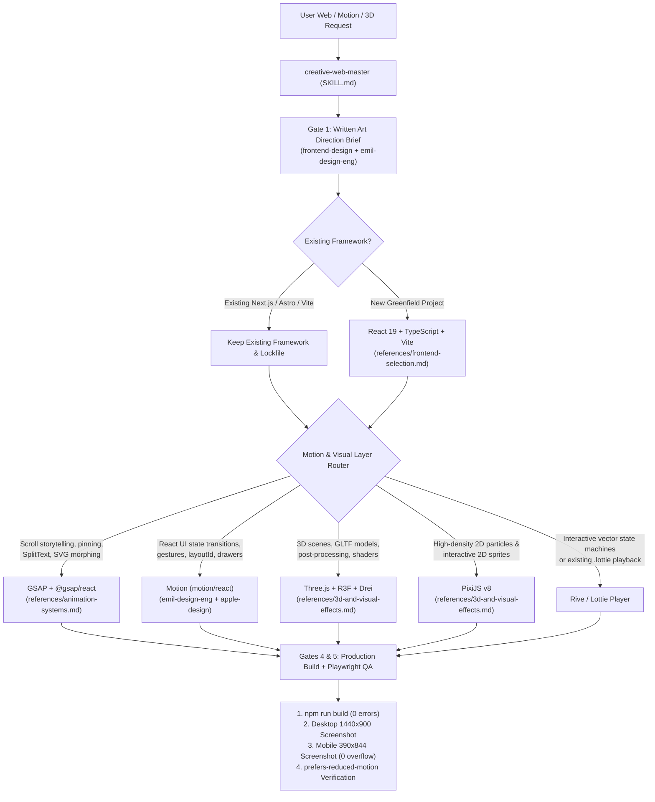
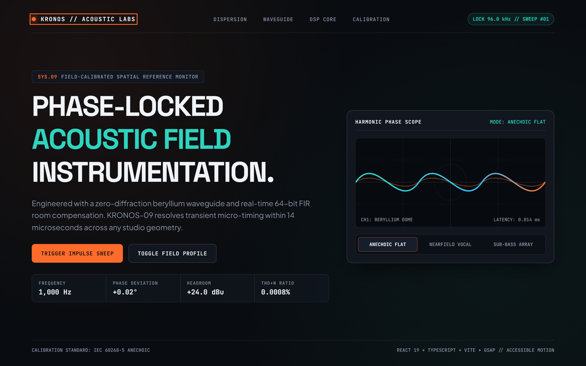
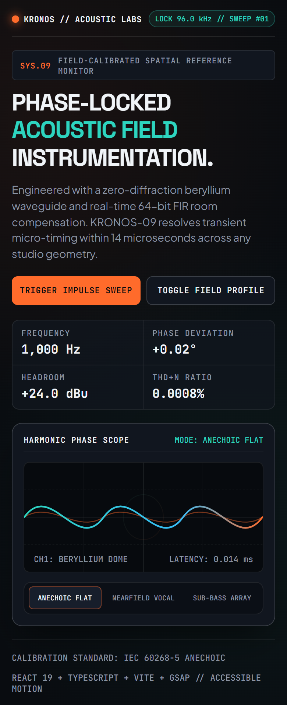

# ⚡ `creative-web-master` — Master Creative Frontend, Motion & 3D Web Skill for Google Antigravity

[](https://github.com/mikmidhun123/creative-web-master/releases/tag/v1.0.0)
[](https://github.com/mikmidhun123/creative-web-master)
[](#2-framework--single-engine-router)
[](./LICENSE)

**`creative-web-master`** is an authoritative master router and creative engineering skill for **Google Antigravity (AGY)**. It governs interactive websites, high-craft landing pages, scroll-driven storytelling, kinetic typography, WebGL/3D experiences, and tactile UI micro-interactions—enforcing a **Written Art Direction Brief**, a **Single Animation Engine Rule**, **`prefers-reduced-motion` accessibility**, and **mandatory Playwright desktop + mobile verification**, while automatically dispatching to **14 specialized sub-skills**.

---

## ✨ Key Capabilities

- **Art Direction First**: Bans generic SaaS templates and unrequested visual slop by requiring a structured **Art Direction Brief** (aesthetic persona, fluid `clamp()` typography scale, purposeful palette, spatial rhythm, and motion signature) before writing code.
- **Framework Preservation & Smart Default**: Respects any existing project framework (`Next.js`, `Astro`, `SvelteKit`, `Remix`, `Vue/Nuxt`), and defaults greenfield creative web projects to **React 19 + TypeScript + Vite**.
- **Single Animation Engine Per Layer**: Prevents bundle bloat and competing `requestAnimationFrame` loops by enforcing a strict separation between **GSAP** (scroll timelines, pinning, SplitText, SVG morphing) and **Motion** (stateful React UI transitions, `AnimatePresence`, shared `layoutId` springs), plus dedicated rendering layers for **3D (`@react-three/fiber` + `@react-three/drei`)**, **2D Particles (`pixi.js`)**, **Interactive State Vectors (`@rive-app/react-canvas`)**, and **Opt-in Smooth Scroll (`lenis`)**.
- **Automatic Sub-Skill Dispatcher**: Automatically routes user intent across **14 specialized supporting skills** (`frontend-design`, `emil-design-eng`, `motion-design`, `animate`, `apple-design`, `animation-performance`, `review-animations`, `improve-animations`, `find-animation-opportunities`, `animation-vocabulary`, `ask-sonner`, and more).
- **Mandatory Verification Gate**: Every job must pass both a **Production Build (`npm run build`)** and **Playwright Headless Browser Verification** across Desktop (`1440×900`), Mobile (`390×844` with `scrollWidth <= innerWidth` assertion), and `prefers-reduced-motion: reduce`.

---

## 🧭 Architecture & Routing Flow



---

## 1. When to Trigger (and When NOT to Trigger)

| Trigger `creative-web-master` when... | Do NOT trigger when... |
| :--- | :--- |
| Building interactive websites, marketing landing pages, portfolios, or design-engineered web apps | Rendering or exporting MP4/MOV/WebM video files or editing camera footage (use [`video-production-master`](https://github.com/mikmidhun123/video-production-master)) |
| Implementing scroll-driven storytelling, pinned choreography, kinetic typography, or SVG morphing | Working on headless backend APIs, database migrations, or CLI utilities without a web frontend |
| Adding 3D WebGL scenes (`Three.js` / `React Three Fiber`), 2D particle canvases (`PixiJS`), or interactive vectors (`Rive`) | — |
| Designing or auditing tactile React UI transitions, spring gestures, popovers, drawers, or toast systems | — |

---

## 2. Framework & Single-Engine Router

> [!IMPORTANT]
> **One Primary Timeline/UI Engine Per Job**: Never install both GSAP and Motion to animate the same DOM elements, and never install animation libraries globally (`npm i -g`). Install libraries per-project only when required by the task.

| Layer / Requirement | Default Choice | Strict Guardrails |
| :--- | :--- | :--- |
| **Existing Project** | **Keep Existing Framework** | Inspect `package.json` and lockfiles first. Never migrate an existing project to another framework unless explicitly asked. |
| **New Greenfield Site** | **React + TypeScript + Vite** | Scaffold with Vite (`react-ts` template). |
| **Next.js Project** | **Stay on Next.js** | Respect App Router (`app/`) vs. Pages Router (`pages/`). Add `'use client'` at the leaf component boundary for animated/WebGL views. |
| **Scroll Storytelling, Complex Timelines, SVG & Kinetic Text** | **GSAP (`gsap` + `@gsap/react`)** | Always wrap GSAP setup inside `useGSAP(() => { ... }, { scope: containerRef })` so ScrollTriggers and SplitText revert cleanly on unmount. |
| **React UI State Transitions, Mount/Unmount & Layout Springs** | **Motion (`motion/react`)** | Use for stateful React UI (`AnimatePresence`, `layoutId`, gestures, drawers, modals). |
| **3D Scenes, Shaders & WebGL Environments** | **Three.js + `@react-three/fiber` + `@react-three/drei`** | Cap device pixel ratio (`dpr={[1, 2]}`), dispose geometries/materials, and lazy-load heavy 3D canvases. Read [`references/3d-and-visual-effects.md`](./references/3d-and-visual-effects.md). |
| **High-Density 2D Particles & 2D WebGL Sprites** | **PixiJS (`pixi.js`)** | Use for 1,000+ 2D particles or 2D interactive canvases instead of DOM nodes. |
| **Interactive State-Machine Vector Graphics** | **Rive (`@rive-app/react-canvas`)** | Use when vectors react to cursor tracking, clicks, or state machine inputs. |
| **Pre-Authored After Effects / Lottie JSON** | **Lottie (`@lottiefiles/dotlottie-react`)** | **Playback only for existing `.json` / `.lottie` assets.** Never hand-write raw Lottie JSON from scratch. |
| **Smooth Inertial Scrolling** | **Lenis (`lenis`)** | **Opt-in only:** Install ONLY when the user explicitly requests smooth scrolling. |

---

## 3. Automatic Sub-Skill Dispatcher Table

Once `creative-web-master` is active, it inspects the user's goal and automatically loads the corresponding supporting `SKILL.md`:

| User Intent / Specific Task | Supporting Skill(s) Loaded Automatically |
| :--- | :--- |
| **Establish visual direction, typography, color palette, and non-generic layout** | `frontend-design` + [`references/art-direction.md`](./references/art-direction.md) |
| **Polish micro-interactions, unseen UI details, popovers, drawers, and restraint** | `emil-design-eng` |
| **Design spring physics, gesture-driven sheets, momentum, and translucent surfaces** | `apple-design` |
| **Build a new component animation from scratch (tool, property, curve, duration)** | `animate` + `motion-design` |
| **Critique or review an existing animation diff or PR** | `review-animations` |
| **Audit an entire codebase and produce a prioritized motion improvement plan** | `improve-animations` |
| **Identify places in a static UI that would benefit from purposeful motion** | `find-animation-opportunities` |
| **Diagnose dropped frames, layout thrashing, paint storms, or WebGL jank** | `animation-performance` |
| **Look up the exact technical term for a described motion effect** | `animation-vocabulary` |
| **Implement or troubleshoot React toast notifications (`sonner`)** | `ask-sonner` |
| **Intentionally stress-test a UI layout or prototype a throwaway interaction** | `break-ui` / `prototype` |

---

## 4. The 5-Gate Creative Engineering Workflow

1. **Gate 1 — Written Art Direction Brief**: Before writing component code, document:
   - **Aesthetic Persona & Reference Direction** (e.g., Swiss Brutalist Editorial, Precision Industrial Dark, Tactile Neo-Print)
   - **Typography Pairing & Fluid Scale** (Display/Headline font, Body font, Mono label font, `clamp()` sizing, optical tracking)
   - **Color Tokens** (Surface hierarchy, primary/secondary text, accent token, border hairlines, WCAG AA contrast check)
   - **Spatial Grid & Rhythm** (Max container width, column system, section padding, asymmetric focal points)
   - **Motion Signature & Engine Choice** (Exact single animation engine selected, easing curves/springs, entry/scroll/hover choreography, and reduced-motion fallback)
2. **Gate 2 — Stack Inspection & License Check**:
   - Inspect existing `package.json` or initialize Vite (`react-ts`).
   - Verify the license of every animation/3D library before adding it (`MIT` vs. Webflow's **Standard "No-Charge" GSAP License**).
3. **Gate 3 — Accessible & Performant Implementation**:
   - Animate compositor-friendly properties (`transform`, `opacity`, `filter`, `clip-path`).
   - **Accessibility Contract**: Respect `prefers-reduced-motion: reduce` (via `gsap.matchMedia()`, `useReducedMotion()`, or CSS `@media (prefers-reduced-motion: reduce)`) so all content remains 100% readable when motion is disabled, and ensure full keyboard navigation (`:focus-visible`).
4. **Gate 4 — Production Build Verification**:
   - Run the project's typechecker and production build (`npm run build`) and resolve all TypeScript or bundler errors.
5. **Gate 5 — Mandatory Playwright Visual & Layout Verification**:
   - Render the built site in headless Chromium via Playwright at **Desktop (`1440×900`)** and **Mobile (`390×844`)**.
   - Assert zero console/page errors, zero horizontal overflow (`document.documentElement.scrollWidth <= window.innerWidth`), visible hero typography, and clean `prefers-reduced-motion: reduce` rendering.

---

## 5. Installation Guide

### Option A: Install via Release Archive (Fastest)

1. Download **`creative-web-master-v1.0.0.zip`** (standalone master skill) or **`creative-web-master-full-bundle-v1.0.0.zip`** (master skill + all 14 supporting skills + Playwright verification script & demo screenshots) from the [**Latest Release**](https://github.com/mikmidhun123/creative-web-master/releases/tag/v1.0.0).
2. Extract into your Google Antigravity skills directory:
   - **Global installation (All Workspaces)**:
     - **Windows**: `C:\Users\<YourUser>\.gemini\antigravity\skills\creative-web-master` (and optionally `C:\Users\<YourUser>\.gemini\config\skills\creative-web-master`)
     - **macOS / Linux**: `~/.gemini/antigravity/skills/creative-web-master`
   - **Workspace-only installation**:
     - `<your-project>/.agent/skills/creative-web-master`

### Option B: Clone Directly with Git

```bash
# Global Antigravity skills directory
git clone https://github.com/mikmidhun123/creative-web-master.git ~/.gemini/antigravity/skills/creative-web-master

# Or inside a specific project workspace
git clone https://github.com/mikmidhun123/creative-web-master.git .agent/skills/creative-web-master
```

### Option C: Install the 14 Supporting Skills from Upstream Repositories

If you installed only the standalone master skill (`Option B`), you can install the 14 supporting skills from their upstream repositories (or simply extract `creative-web-master-full-bundle-v1.0.0.zip`):

| Upstream Repository | Supporting Skills Installed | License |
| :--- | :--- | :--- |
| [`anthropics/skills`](https://github.com/anthropics/skills) | `frontend-design` | Apache-2.0 |
| [`emilkowalski/skills`](https://github.com/emilkowalski/skills) | `emil-design-eng`, `ask-sonner`, `break-ui`, `prototype`, `research`, `writing-for-agents` | MIT |
| [`LottieFiles/motion-design-skill`](https://github.com/LottieFiles/motion-design-skill) | `motion-design` | MIT |
| [`Barty-Bart/motion-graphics`](https://github.com/Barty-Bart/motion-graphics) | `animate`, `animation-performance`, `animation-vocabulary`, `apple-design`, `find-animation-opportunities`, `improve-animations`, `review-animations` | MIT |

---

## 6. Repository Structure

```text
creative-web-master/
├── SKILL.md                           # Master router skill (<300 lines, frontmatter + dispatcher + 5 gates)
├── references/
│   ├── frontend-selection.md          # Framework detection, React+TS+Vite scaffold, Next.js rules, license matrix
│   ├── animation-systems.md           # Single-engine rule (GSAP vs Motion vs CSS), Rive, Lottie, Lenis, a11y
│   ├── 3d-and-visual-effects.md       # Three.js + R3F + Drei, PixiJS v8, DPR capping, WebGL disposal
│   └── art-direction.md               # Pre-code Art Direction Brief template, fluid type scale, anti-slop rules
├── examples/
│   ├── ART_DIRECTION_BRIEF.md         # Example Gate 1 Art Direction Brief ("AETHER // 01")
│   ├── verify-ui.mjs                  # Automated Playwright Desktop + Mobile + Reduced-Motion QA script
│   └── screenshots/                   # Verified Playwright screenshots
│       ├── desktop-1440x900.png       # Desktop 1440x900 viewport verification
│       └── mobile-390x844.png         # Mobile 390x844 viewport verification (0 horizontal overflow)
├── CHANGELOG.md                       # Version history & release notes
├── LICENSE                            # MIT License
└── README.md                          # Complete documentation
```

---

## 7. Verified Demo Showcase (`AETHER // 01`)

Below are the automated Playwright verification screenshots from the **React 19 + TypeScript + Vite + GSAP** editorial hero demo built and verified with `creative-web-master`:

| Desktop Viewport (`1440×900`) | Mobile Viewport (`390×844`) |
| :---: | :---: |
|  |  |

### Verified Playwright Telemetry (`examples/verify-ui.mjs`)
- **Desktop (`1440×900`)**: `scrollWidth: 1440`, `innerWidth: 1440`, `overflowPx: 0`, `consoleErrors: 0`
- **Mobile (`390×844`)**: `scrollWidth: 390`, `innerWidth: 390`, `overflowPx: 0`, `consoleErrors: 0`
- **Reduced Motion (`prefers-reduced-motion: reduce`)**: `opacity: 1` (instant reveal via `gsap.matchMedia()`), `consoleErrors: 0`

---

## 8. Animation & 3D Library License Reference

Always verify third-party library licenses before adding dependencies to a project:

| Library | NPM Package(s) | License | Commercial Use Notes |
| :--- | :--- | :--- | :--- |
| **Motion** | `motion` | **MIT** | Unrestricted commercial and open-source use. |
| **Three.js / R3F / Drei** | `three`, `@react-three/fiber`, `@react-three/drei` | **MIT** | Unrestricted commercial and open-source use. |
| **PixiJS** | `pixi.js` | **MIT** | Unrestricted commercial and open-source use. |
| **Lenis** | `lenis` | **MIT** | Unrestricted commercial and open-source use. |
| **Rive Runtime** | `@rive-app/react-canvas` | **MIT** | Runtime is MIT. |
| **DotLottie Player** | `@lottiefiles/dotlottie-react` | **MIT** | Player is MIT. |
| **GSAP** | `gsap`, `@gsap/react` | **Webflow Standard "No-Charge" License** | Free for 100% of standard websites, apps, and client work (including ScrollTrigger, SplitText, MorphSVG, Flip). Only requires a paid commercial license if redistributing GSAP inside a paid authoring tool where end users pay to build animations. |

---

## 📄 License

Released under the [MIT License](./LICENSE).
